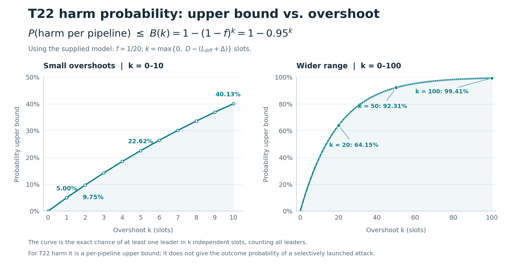

# lean-leios

A minimal Lean 4 model of Linear Leios for analysing T22 of the threat model: an adversary
lets an EB get certified while withholding it from most honest nodes, so that the certificate
RB cannot be selected in time.

## Model and assumptions

- Times are slot numbers; "by slot `t`" means `recv ≤ t`. The Praos paper uses strict
  inequalities (`i + Δ < j`), so boundaries shift by one slot when mapping between the two.
- `Δ` is the Praos `Δ`-semi-synchrony bound, applied to RBs only. `D` is the same kind of bound
  applied to EBs and is kept separate because EBs are several times larger than RBs; the
  theorems state by how much `D` may exceed `Δ`, namely by `Ldiff`.
- "Holding" an EB means its closure is fetched and validated against the announcing RB's state,
  for a voter and for a node selecting the certificate RB alike. The CIP budgets this
  reapplication separately from diffusion; here it is folded into `D`, so a measured diffusion
  time needs the validation time added.
- Verifying the certificate and applying the certificate RB is per-RB work assumed to fit in
  `Δ` like any RB. This is a composition assumption, not something proved here.
- The quorum `τ` is assumed at least one half (`Params.τ_ge_half`); with an honest majority this
  makes a certificate evidence of at least one honest vote.
- Two voting rules are modelled through `voteRecvOffset`: the prototype votes if the EB is held
  by the vote deadline (`3·Lhdr + Lvote`), the Agda/CIP specification requires it within `Lhdr`.
- The theorems in `Leios/T22.lean` take the offset as a parameter. Their condition
  `voteRecvOffset + D ≤ certGap + Δ` reduces under the prototype rule to `D ≤ Ldiff + Δ`
  (`12 ≤ 7 + 5` with the glossary values); `t22_cannot_happen` shows the attack fails under it
  and `t22_can_happen` builds a witness when it fails.

## Conclusion

T22 is a parameter-sizing question, and the model gives it a sharp edge. The attack is
impossible exactly when the EB diffusion time fits its budget, `D ≤ Ldiff + Δ` under the
prototype's voting rule (`t22_cannot_happen`), and possible as soon as it does not
(`t22_can_happen`). The whole argument rests on one network assumption, `HonestDiffuse`: an EB
held by one honest node reaches every honest node within `D` slots. Honest majority and the
quorum are only used to show that a certificate contains at least one honest vote.

When `Ldiff` is too small by `k` slots, the harm is confined to a window of `k` certificate
slots, so per pipeline it needs the Praos lottery to elect a leader there. That happens with
probability at most `1 − (1 − f)^k`, about five percent per slot of overshoot on mainnet
(`f = 1/20`). The bound degrades gracefully, as the plot shows, but it is a bound on how often
the timing lines up, not on the outcome of an attack the adversary launches only when it
already knows it holds a leader slot in the window.

### The failure mode is Praos with a larger `Δ`

What a successful attack does to Praos is bounded too. By `recv_le_of_certified`, every honest
node holds the EB by `s + voteRecvOffset + D`, and a certificate RB sits at `c ≥ s + certGap`,
so the EB, and with it the certificate RB, is late at any honest node by at most `k` slots
beyond `Δ`. In other words, a harmed slot is a slot in which the Praos delivery bound is `Δ + k`
instead of `Δ`. Praos's guarantees (common prefix, chain growth and chain quality) are proved
for any delivery bound, with the security parameters depending on it. So even in the worst
case, where every pipeline is harmed, the execution is an ordinary Praos run with delivery
bound `Δ + k`: the same guarantees hold, with the security margin that Praos has at `Δ + k`
rather than at `Δ`. Leios does not break Praos through T22; a too-small `Ldiff` degrades the
Praos security argument by the overshoot, and in a fraction of slots bounded by the plot
below.



## Build

```sh
nix develop
lake exe cache get   # Mathlib oleans
lake build --wfail
```

## Map

| file                 | contents                                              |
|----------------------|-------------------------------------------------------|
| `Leios/Params.lean`  | protocol and environment parameters                   |
| `Leios/Model.lean`   | one pipeline: parties, stake, votes, diffusion, harm  |
| `Leios/T22.lean`     | T22 cannot happen iff `L_diff` is sized for `D`        |
| `Leios/Prob.lean`    | probability bound when `L_diff` is `k` slots too small |
