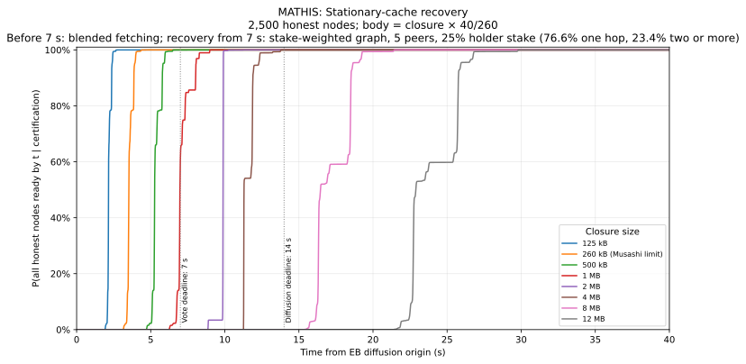
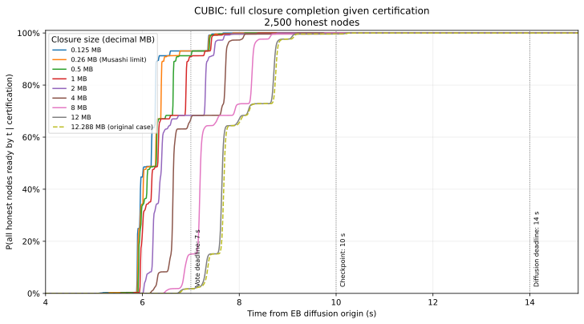
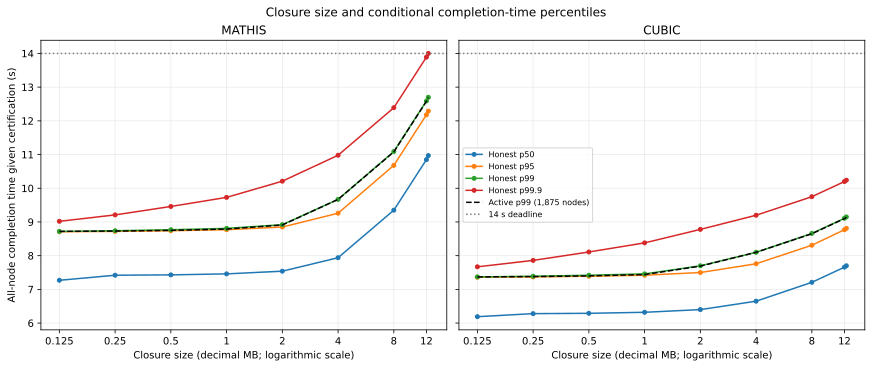
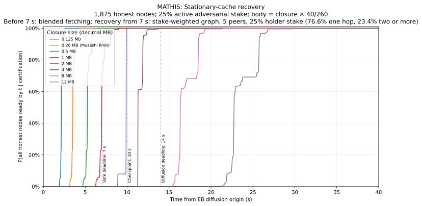
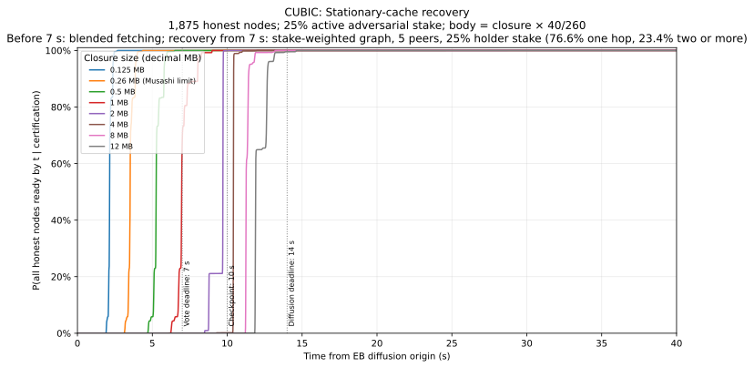
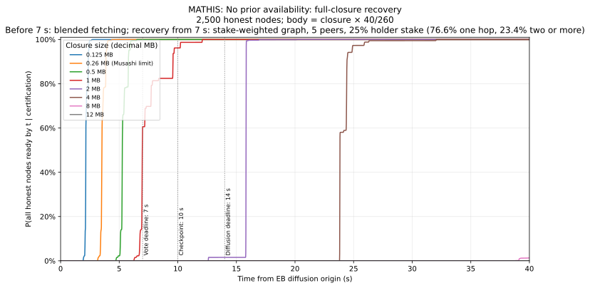
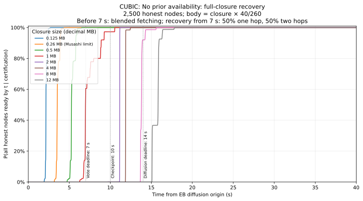
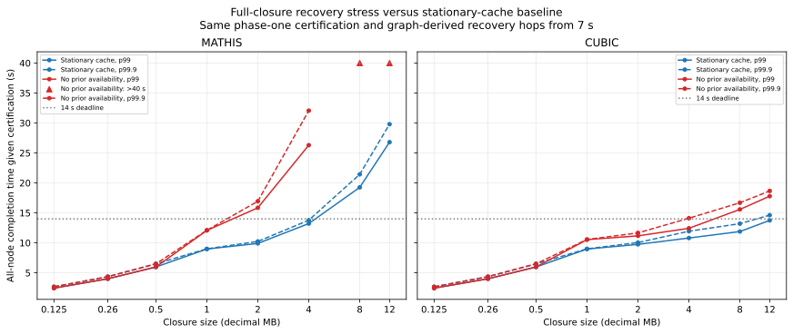
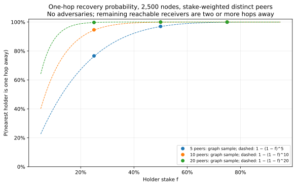

# Leios closure diffusion after certification: numerical report

## Summary

This report estimates the probability that **all honest nodes have received and
processed an endorser block's (EB's) transaction closure, given that the EB
certifies**. It extends the
[conditional-certification analysis](../analysis/deltaq/improved-leios/conditional_certification_diffusion.md)
with **125 kB, 260 kB, and 500 kB closures**, alongside 1–12 MB closures.
Results are model estimates, including CPU processing, rather than measurements.

The **260 kB case is Musashi's configured transaction-closure limit**.  At
that size, the honest all-node p99 completion time is **4.01 s under both
network models**.  The committee selects the **900 highest-stake
pools**, matching the current implementation and Musashi's seat-count parameter.
Every table and plot uses a **causal two-phase model**: blended fetching and
validation before the 7-second deadline, then **graph-derived recovery for
nodes still missing data** on certification (76.58% one hop, 23.41% two hops,
0.01% three hops), with **EB body size = closure size × 40/260**.
At 260 kB, the body is 40 kB and p99.9 is **4.36 s under both models**.
The stationary missing fraction is **one sixth at every node**; it is not
a one-sixth probability that a node needs to fetch anything.

- **At the 14-second deadline**, closures up to 2 MB have **>99.9999%**
  all-node completion under both network models, with effectively certain
  certification.  At 4 MB, Mathis has **99.9988%** and CUBIC **>99.9999%**.
  At 8 MB, Mathis has **<0.0001%** all-node completion by 14 s, while CUBIC
  has **99.9999%**, conditional on certification.  These bounds do not imply
  impossibility or certainty.
- **Smaller closures finish earlier.** Reducing the closure from 4 MB to 0.5 MB
  reduces the all-node 99th-percentile completion time from **13.22 s to 5.98 s**
  under Mathis and from **10.81 s to 5.98 s** under CUBIC.
- **Certification is effectively certain through 2 MB under both models.**
  CUBIC gives **99.6413%** certification at 4 MB.  For Mathis closures of
  4 MB and above, and CUBIC closures of 8 MB and above,
  certification becomes extremely rare.  Quorum probabilities use a seeded
  permutation estimate, not a Normal tail; extreme-tail values remain
  sensitive to the finite permutation sample and synthetic stake distribution.
- **No-prior-availability stress:** §3.4 makes every node not validated by
  7 s recover the entire closure.  At 260 kB, p99 remains **4.01 s** under
  both models because the all-node p99 event precedes recovery.  At 2 MB,
  Mathis p99 rises from **9.91 s to 15.85 s** and all-node completion by
  14 s falls to **1.5397%**, conditional on the same certification event.
- **Recovery paths come from a stake-weighted peer graph** (§3.5).  With *m*
  peers per node chosen by stake, and holders carrying stake fraction *f*, a
  recovering node reaches a holder in one hop with probability close to
  1 − (1 − *f*)^*m*.  The timing model uses *f* = 25% and *m* = 5, the
  smallest holder stake and peer count in the sweep.

## 1. What the numbers mean

The **closure size** is the total size of referenced transactions, not the EB
body size and not the amount each node must fetch. With the assumed cache miss
rate of one sixth, a 500 kB closure requires fetching approximately **83.33 kB**
of missing transactions; the node still processes the whole closure.

Two different probabilities appear below:

- **Voter ready by 7 s:** one node has received the body, fetched its missing
  transactions, and completed the voter validation work by the voting deadline.
- **All ready by t, given C:** every honest node has received the body, fetched
  its missing transactions, and completed reapplication by time *t*, conditional
  on the certification event *C*. This is a strict **all-node** target, not an
  average node, a stake fraction, or 99% of nodes.

All times are measured from the model's EB diffusion origin. The checkpoints
are **7 s** (voting deadline), **10 s** (intermediate checkpoint), and **14 s**
(end of the diffusion window). A p99 time is the time by which the all-node
completion event has probability at least 99%, conditional on certification.
An early completion time does not mean that the certificate itself has already
been delivered to every node: certificate propagation is not a stage of this
closure-completion calculation.

### Fixed inputs

| Input | Value used |
|:---|:---|
| Node population | 2,500; all honest in the baseline |
| Committee | Deterministic top-stake selection of 900 pools; synthetic stake coverage approximately 98.844483% |
| Committee size / effective equal-weight votes | 900 / approximately 464 |
| Stake distribution | Synthetic power-law distribution in `analysis.py`; not an observed stake snapshot |
| Certification threshold | 75% of total active stake; approximately 75.88% of committee stake |
| Voting / diffusion deadline | 7 s / 14 s |
| Stationary missing transaction fraction | Every node fetches 1/6 of the closure (approximately 16.67%) |
| Phase-one missing-transaction fetch | Full blended one-to-five-hop distribution; determines voter readiness and P(C) |
| Phase-two recovery | Begins no earlier than 7 s, conditional on certification: 76.58% one hop, 23.41% two hops, 0.01% three hops; see §3.1 and §3.5 |
| Recovery graph | 2,500 nodes; 5 distinct stake-weighted peers each; holders carry 25% of stake; 16 graphs and 256 holder draws, seed 164 |
| Stress recovery | Every node not validated by 7 s fetches the full closure; same phase one and recovery-hop distribution; see §3.4 |
| EB-body diffusion | Full blended one-to-five-hop distribution from `report.md` §4.2 |
| EB body | Fixed size for each closure: closure size × 40/260; 40 kB at a 260 kB closure |
| Average transaction size | 1,000 bytes |
| CPU means | Initial validation: approximately 0.1428 ms/transaction; recovery reapply: 0.070 ms/transaction |
| Quorum calculation | 50,000 seeded pool permutations (seed 164); binomial mixture evaluated in log space |
| Network models | Mathis (Reno/AIMD) and CUBIC |
| Packet loss / interface cap | 0.0001 / 1 Gbit/s |
| Short / medium / long RTT | 12 / 69 / 268 ms |
| Numerical time grid | 10 ms, extending to 40 s |

The selection rule follows the ledger's
[`selectLeiosCommittee`](https://github.com/IntersectMBO/cardano-ledger/blob/leios-prototype/libs/cardano-ledger-core/src/Cardano/Ledger/State/LeiosCommittee.hs):
take the configured number of pools in descending active-stake order, or all
candidates if fewer; equal-stake ties use ascending pool ID.  The synthetic
model carries no pool IDs, so equal-stake ties are interchangeable.  Coverage
is an outcome of selection, not a 99% target.  All selected seats are assumed
to have usable voting keys; the implementation can retain keyless seats when
keys are missing, expired, or have invalid proofs of possession.

The [pinned Musashi genesis](../testnet/config/dijkstra-genesis.json) sets
`leiosCommitteeSize=900`, `maxEndorserBlockTxsSize=260000`, and the separate
references-size limit to 40,000 bytes.  The 260 kB closure limit is a maximum,
not a measured average; transaction supply, packing, and execution limits can
produce smaller closures.  Its missing-transaction fetch is approximately
43.33 kB under the assumed one-sixth miss rate.  This remains an isolated-EB,
2,500-node model with the timing and network inputs above, rather than a full
calibration to Musashi's population, stake snapshot, or period lengths.

The same body-to-closure ratio applies to every size, without a cap.  For
example, a 4 MB closure has a 615.385 kB body and a 12 MB closure has a
1,846.15 kB body.  This is a modelling rule, not a measured encoding ratio;
larger rows extrapolate beyond Musashi's 40 kB references-size limit and
should not be interpreted as valid Musashi configurations.

**Units**: all sizes in this report use decimal units: kB = 1,000 bytes
and MB = 1,000,000 bytes.

## 2. Certification and completion probabilities

Very small certification probabilities are displayed in scientific notation
as percentages, rather than rounded to zero.
Certification and conditional probabilities are evaluated in log space; even
the extremely small Mathis tails remain numerically representable as logs.
Every closure size has a plotted curve.  Scientific notation does not imply
that such extreme tails are empirically calibrated.

The baseline has no adversarial nodes. All probabilities are percentages,
rounded to four decimal places.  Values that would round to zero or one
hundred percent are displayed as `<0.0001%` or `>99.9999%`, respectively,
rather than implying impossibility or certainty.  Smaller closures saturate
the 14-second column; §3 gives their more informative completion-time differences.

### Mathis: Reno/AIMD network model

| Closure (MB) | Body (kB) | Missing txs (kB) | Voter ready by 7 s | P(C) | All ready by 7 s, given C | All ready by 10 s, given C | All ready by 14 s, given C |
|---:|---:|---:|---:|---:|---:|---:|---:|
| 0.125 | 19.2308 | 20.8333 | >99.9999% | >99.9999% | >99.9999% | >99.9999% | >99.9999% |
| 0.26 | 40 | 43.3333 | >99.9999% | >99.9999% | >99.9999% | >99.9999% | >99.9999% |
| 0.5 | 76.9231 | 83.3333 | >99.9999% | >99.9999% | 99.9967% | >99.9999% | >99.9999% |
| 1 | 153.846 | 166.667 | 99.9800% | >99.9999% | 60.5871% | >99.9999% | >99.9999% |
| 2 | 307.692 | 333.333 | 93.5955% | >99.9999% | <0.0001% | 99.7281% | >99.9999% |
| 4 | 615.385 | 666.667 | 55.1347% | 6.4872e-23% | <0.0001% | <0.0001% | 99.9988% |
| 8 | 1230.77 | 1333.33 | 16.6900% | 1.7273e-278% | <0.0001% | <0.0001% | <0.0001% |
| 12 | 1846.15 | 2000 | 4.6231% | 1.6401e-614% | <0.0001% | <0.0001% | <0.0001% |

### CUBIC network model

| Closure (MB) | Body (kB) | Missing txs (kB) | Voter ready by 7 s | P(C) | All ready by 7 s, given C | All ready by 10 s, given C | All ready by 14 s, given C |
|---:|---:|---:|---:|---:|---:|---:|---:|
| 0.125 | 19.2308 | 20.8333 | >99.9999% | >99.9999% | >99.9999% | >99.9999% | >99.9999% |
| 0.26 | 40 | 43.3333 | >99.9999% | >99.9999% | >99.9999% | >99.9999% | >99.9999% |
| 0.5 | 76.9231 | 83.3333 | >99.9999% | >99.9999% | 99.9967% | >99.9999% | >99.9999% |
| 1 | 153.846 | 166.667 | 99.9800% | >99.9999% | 60.5871% | >99.9999% | >99.9999% |
| 2 | 307.692 | 333.333 | 94.9502% | >99.9999% | <0.0001% | 99.8332% | >99.9999% |
| 4 | 615.385 | 666.667 | 80.9318% | 99.6413% | <0.0001% | 0.0165% | >99.9999% |
| 8 | 1230.77 | 1333.33 | 54.3077% | 5.9575e-25% | <0.0001% | <0.0001% | 99.9999% |
| 12 | 1846.15 | 2000 | 36.9762% | 5.2942e-93% | <0.0001% | <0.0001% | 99.3888% |

A high individual voter readiness probability does not imply that every node
is ready.  For example, at 2 MB under Mathis, individual voter readiness at
7 s is **93.5955%**, while all-node completion is **<0.0001%**.
Certification only requires the stake quorum, so it remains effectively certain.

### Conditional completion CDFs

All plots and tables use the **two-phase node process** defined
in §3.1; the graph-derived recovery-hop distribution does not enter P(C).

Each curve shows the probability that all 2,500 honest nodes are ready by
time *t*, given certification, for one closure size. Vertical dotted lines
mark the 7, 10, and 14 s table checkpoints.  Colours identify the same
closure sizes in all four CDF plots.





## 3. Completion times and active-adversary comparison

The honest columns target all **2,500** nodes. The active-adversary columns
use the original note's scenario: an adversary controls **25% of committee
stake** and always votes on time, independently of honest diffusion. The model
also reduces the honest node target to **1,875**, assuming the same adversarial
fraction by node count. A stake fraction alone does not imply that node count.

Where certification is effectively certain, the slightly
earlier active p99 values mainly reflect the smaller completion target;
they are not evidence that adversarial voting improves diffusion. Comparisons
of the informational strength of certificates require holding the honest
population fixed.

### Mathis

| Closure (MB) | Honest p50 (s) | Honest p95 (s) | Honest p99 (s) | Honest p99.9 (s) | Active p99 (s) | Active all ready by 14 s, given C |
|---:|---:|---:|---:|---:|---:|---:|
| 0.125 | 2.16 | 2.40 | 2.45 | 2.67 | 2.45 | >99.9999% |
| 0.26 | 3.53 | 3.92 | 4.01 | 4.36 | 4.01 | >99.9999% |
| 0.5 | 5.27 | 5.83 | 5.98 | 6.50 | 5.98 | >99.9999% |
| 1 | 6.98 | 8.06 | 8.97 | 9.00 | 8.28 | >99.9999% |
| 2 | 9.88 | 9.90 | 9.91 | 10.24 | 9.91 | >99.9999% |
| 4 | 11.30 | 12.29 | 13.22 | 13.78 | 12.38 | 99.9991% |
| 8 | 16.46 | 18.64 | 19.26 | 21.43 | 19.25 | 0.0015% |
| 12 | 22.89 | 25.93 | 26.80 | 29.80 | 26.78 | <0.0001% |

### CUBIC

| Closure (MB) | Honest p50 (s) | Honest p95 (s) | Honest p99 (s) | Honest p99.9 (s) | Active p99 (s) | Active all ready by 14 s, given C |
|---:|---:|---:|---:|---:|---:|---:|
| 0.125 | 2.16 | 2.40 | 2.45 | 2.67 | 2.45 | >99.9999% |
| 0.26 | 3.53 | 3.92 | 4.01 | 4.36 | 4.01 | >99.9999% |
| 0.5 | 5.27 | 5.83 | 5.98 | 6.50 | 5.98 | >99.9999% |
| 1 | 6.98 | 8.06 | 8.97 | 9.00 | 8.28 | >99.9999% |
| 2 | 9.72 | 9.74 | 9.75 | 10.05 | 9.75 | >99.9999% |
| 4 | 10.42 | 10.44 | 10.81 | 11.94 | 10.78 | >99.9999% |
| 8 | 11.27 | 11.80 | 11.89 | 13.20 | 11.88 | 99.9999% |
| 12 | 11.91 | 13.08 | 13.75 | 14.62 | 13.18 | 99.5350% |

At 0.5 MB, the honest p99 time leaves **8.02 s** before the 14-second
deadline under both models.  At 4 MB, conditional p99 leaves **0.78 s under
Mathis** and **3.19 s under CUBIC**; the Mathis certificate itself is extremely
unlikely.  These are model timing margins, not measured
budgets for additional traffic or implementation overhead.

### Completion-time percentiles by closure size

The percentile plot uses a logarithmic closure-size axis to keep the smaller
sizes legible. Each panel includes the honest p50, p95, p99, and p99.9 times,
with the active-adversary p99 shown as a dashed black line.  The rightmost
point is 12 MB under both models.
Where certification saturates, the
active line nearly overlaps honest p99 because the main difference is the
smaller honest-node target.  Conditioning on rare certification also changes
the distribution of nodes already ready at the deadline.  The new calculation
does not impose monotonicity by taking a running maximum of the CDF.



### Active-adversary conditional completion CDFs

These use the same axes and size colours as the honest-baseline plots, but
target all 1,875 honest nodes under the 25% active-adversary scenario.
Both honest and active-adversary plots use the split fetch assumptions.





### 3.1. Fixed missing-transaction fetch model

The model uses separate paths for the **whole missing-transaction batch**
before and after the voting deadline:

| Path length | Phase-one fetch | Phase-two recovery |
|---:|---:|---:|
| 1 hop | 0.40% | 76.58% |
| 2 hops | 3.91% | 23.41% |
| 3 hops | 31.06% | 0.01% |
| 4 hops | 61.85% | 0% |
| 5 hops | 2.78% | 0% |

**Phase one:** every honest node attempts to acquire and validate the closure.
Voter readiness and the unconditional certification probability P(C) use only
the full blended fetch law and initial validation.  Nodes outside the committee
also follow this initial processing law, but do not vote.

**Phase two starts at 7 s, conditional on certification.**  A node already
validated remains complete.  A node that has fetched its entire missing batch
continues any validation still in progress.  A node still missing data uses
the short-path recovery law, beginning at the later of 7 s and its body arrival,
then reapplies the closure.  Already completed data fetching is retained;
partial bytes of an unfinished batch are not credited, so that batch is
restarted in full.  This is a deliberately coarse batch-level progress model.

Certified holders are assumed to be immediately available as serving sources
at the deadline.  There is no additional certificate-construction, delivery,
source-discovery, or queueing delay.  Recovery does not happen on a branch
where certification fails.  This is a fixed-deadline model, not a model of
the earliest possible quorum time or per-node certificate arrival.

The generator derives `DEFAULT_HOP_WEIGHTS` from the recovery graph in §3.5
and uses it for recovery only.  These weights come from a graph model; they
are not measured mainnet frequencies.
EB bodies retain the full blended distribution from
[`report.md` §4.2](../analysis/deltaq/improved-leios/report.md#42-network-model),
implemented by `cdf_blended_delay` using `analysis.py`'s `_HOP_PROBS`.
Multi-hop fetching represents data being acquired upstream before it reaches
the requesting node.  Each hop transfers the same missing batch using the existing
short/medium/long-distance transfer law, independently of the other hops;
hop CDFs are convolved sequentially without pipelining.  The EB-body diffusion
and CPU laws are unchanged.

The **stationary transaction-cache miss fraction is 1/6 at every node**.
Each node therefore fetches a batch of size `closure / 6`, with the path
length drawn from the applicable phase's distribution.  There is no additional 5/6
probability of a full-closure cache hit.  This is a mean-fraction approximation:
it does not sample which individual transactions are missing or model them
taking different paths.  The model also omits peer-discovery delays,
timeouts, retries, and contention.

Only the missing fraction traverses these fetch paths; this is not the
§5.3 catastrophic pre-diffusion-failure scenario in `report.md`, in which the
entire closure must traverse the network.

### 3.2. Joint readiness and conditional completion

Let *B* be body arrival, *U* the phase-one missing-batch fetch duration,
*X* initial validation, *R* recovery duration, and *Y* reapplication.  Component
durations are independent; both phases share the same body arrival.  Set
*L = B + U*, *V = L + X*, and define completion *D* on a certified branch by:

$$
D = \begin{cases}
V, & L \le t_v,\\
\max(B,t_v)+R+Y, & L > t_v,
\end{cases}
\qquad t_v=7\ \mathrm{s}.
$$

Thus a node ready to vote is necessarily already complete.  For independent
node histories, the required joint probability is known explicitly:

$$
H(t_v,t)=P(V\le t_v,D\le t)=F_V(\min(t_v,t)).
$$

Writing *A_t* for all honest nodes completing by *t*, the conditional CDF is:

$$
P(A_t\mid C)=F_D(t)^{N_h}
\frac{Q\!\left(H(t_v,t)/F_D(t)\right)}{Q(F_V(t_v))}.
$$

This uses the actual conditional voter probability *H/F_D*, rather than the
old substitution involving *F_V(t_v)/F_V(t)*.  The denominator and phase-one
vote readiness do not change when the recovery-hop distribution changes.
The identity is exact under the independent-node model with an exact *Q*;
the report approximates *Q* using the reproducible method below.

### 3.3. Stake-weighted quorum calculation

For a committee of *K* seats, let *a_k* be the probability that a uniformly
chosen subset of *k* seats carries quorum stake.  Then:

$$
Q(p)=\sum_{k=0}^{K} a_k {K\choose k}p^k(1-p)^{K-k}.
$$

The implementation estimates all *a_k* using **50,000 uniform random pool
permutations**, with **seed 164**.  For each permutation it records the first
prefix whose stake reaches quorum; the empirical CDF of this prefix length
estimates *a_k*.  The same coefficients are used for the denominator and
conditional numerator.  This is not rejection sampling of rare certification
events, and the binomial mixture is evaluated in log space.

The non-negative mixture preserves a consistent probability model: the
conditional curves are bounded and non-decreasing without clipping excursions
or taking a running maximum.  Roundoff at unity is trimmed only within a
small numerical tolerance.  The quorum calculation is still a finite-sample
approximation to the exact stake-weighted distribution; very rare tails can
depend strongly on favourable subsets absent from the sample.

For the stylised active-adversary comparison, 25% of committee weight votes
deterministically and each stochastic seat's weight is scaled by 75%.
This does not identify an actual allocation of adversarial pools; the honest
completion target remains 1,875 nodes, following the earlier comparison.

### 3.4. No prior availability at remaining honest nodes: stress scenario

This scenario removes the stationary-cache availability assumption from
**recovery only**.  Phase-one fetching, validation, and the certification event
are identical to the baseline.  A node already validated by the 7-second
deadline remains complete.  Every other honest node is treated as holding
none of the transactions and fetches the **entire closure**, even if it had
previously acquired data and was still validating it.  Thus the recovery
payload at 260 kB is **260 kB**, compared with **43.33 kB** for a baseline
node still missing data.

Using the notation from §3.2, let *R_full* transfer the full closure over
the same graph-derived recovery-hop distribution.  The stress completion time is:

$$
D_{\mathrm{stress}}=\begin{cases}
V, & V\le t_v,\\
\max(B,t_v)+R_{\mathrm{full}}+Y, & V>t_v.
\end{cases}
$$

The already-ready nodes are retained, so the same joint-readiness identity
and quorum coefficients apply.  Both honest-baseline and active-adversary
certification probabilities are unchanged; only conditional completion changes.
All times below are measured from EB diffusion, not from certification.

#### Mathis

| Closure (MB) | Baseline p99 (s) | Stress p99 (s) | Stress p99.9 (s) | Stress all ready by 14 s, given C | Active stress p99 (s) | Active stress all ready by 14 s, given C |
|---:|---:|---:|---:|---:|---:|---:|
| 0.125 | 2.45 | 2.45 | 2.67 | >99.9999% | 2.45 | >99.9999% |
| 0.26 | 4.01 | 4.01 | 4.36 | >99.9999% | 4.01 | >99.9999% |
| 0.5 | 5.98 | 5.98 | 6.50 | >99.9999% | 5.98 | >99.9999% |
| 1 | 8.97 | 12.08 | 12.10 | 99.9997% | 10.24 | 99.9998% |
| 2 | 9.91 | 15.85 | 16.94 | 1.5397% | 15.85 | 4.3710% |
| 4 | 13.22 | 26.30 | 32.06 | <0.0001% | 25.94 | <0.0001% |
| 8 | 19.26 | >40 | >40 | <0.0001% | >40 | <0.0001% |
| 12 | 26.80 | >40 | >40 | <0.0001% | >40 | <0.0001% |

#### CUBIC

| Closure (MB) | Baseline p99 (s) | Stress p99 (s) | Stress p99.9 (s) | Stress all ready by 14 s, given C | Active stress p99 (s) | Active stress all ready by 14 s, given C |
|---:|---:|---:|---:|---:|---:|---:|
| 0.125 | 2.45 | 2.45 | 2.67 | >99.9999% | 2.45 | >99.9999% |
| 0.26 | 4.01 | 4.01 | 4.36 | >99.9999% | 4.01 | >99.9999% |
| 0.5 | 5.98 | 5.98 | 6.50 | >99.9999% | 5.98 | >99.9999% |
| 1 | 8.97 | 10.54 | 10.56 | >99.9999% | 9.27 | >99.9999% |
| 2 | 9.75 | 11.17 | 11.66 | >99.9999% | 11.17 | >99.9999% |
| 4 | 10.81 | 12.43 | 14.11 | 99.7502% | 12.42 | 99.8125% |
| 8 | 11.89 | 15.58 | 16.69 | 94.1764% | 14.46 | 95.3243% |
| 12 | 13.75 | 17.79 | 18.66 | <0.0001% | 16.42 | <0.0001% |

The stress assumption has no effect on the displayed p99 and p99.9 for
closures through 500 kB: those completion quantiles are already before 7 s,
when the node process is identical.  It substantially increases recovery
times for larger closures.  As throughout the report, a favourable conditional
completion figure does not imply that the certificate is likely to form.

`>40` means the percentile lies beyond the 40-second numerical horizon;
it is not an estimate of the actual percentile.  The Mathis 8 and 12 MB
stress CDFs have not reached the target percentile by the right edge of the
plot.  Upward triangles at 40 s mark these censored cases in the percentile
comparison; they are not plotted as measured 40-second completion times.







This tests the effect of losing prior transaction availability outside the
validated population.  It is not a formal adversarial worst-case bound:
immediate serving availability, short recovery paths, independent requests,
and no serving-capacity contention remain assumptions.  It is a separate
stress scenario rather than a change to the stationary-cache baseline.

### 3.5. Graph-derived recovery paths

The phase-two recovery-hop distribution comes from
[`recovery_graph.py`](../analysis/deltaq/improved-leios/recovery_graph.py),
which builds the following model:

1. Create **2,500 nodes** with the synthetic stake distribution.  Each node
   chooses *m* **distinct peers** in proportion to their stake, excluding
   itself.  An edge *i → j* means that *i* can request data from *j*.
2. Order the nodes uniformly at random.  The shortest prefix carrying at
   least stake fraction *f* holds the closure.  Where an adversary is
   present, the next prefix carrying at least the adversarial stake neither
   serves nor forwards.  All remaining nodes are honest receivers.
3. Find each receiver's shortest path to a holder through honest nodes only.
   Path lengths are pooled over receivers, not over stake.
4. Sample **16 graphs** for each peer count and **256 role draws** for each
   stake split, with **seed 164**.

A stake-weighted peer is a holder with probability close to *f*, so a
receiver reaches a holder in one hop with probability close to
1 − (1 − *f*)^*m*.  Choosing distinct peers makes the sampled value slightly
higher.  The result depends on the holders' stake, not on which nodes they
are.  The holders actually conditioned on certification lean towards
high-stake pools, but for a given *f* this leaves the one-hop probability
unchanged.

| Peers | Holder stake | Adversarial stake | One hop | Closed form | Two hops | Three+ hops | Unreachable | All reachable |
|---:|---:|---:|---:|---:|---:|---:|---:|---:|
| 5 | 25% | 0% | 76.58% | 76.27% | 23.41% | 0.01% | 0.00% | 100.00% |
| 5 | 25% | 25% | 76.64% | 76.27% | 22.70% | 0.57% | 0.09% | 34.38% |
| 5 | 25% | 50% | 76.48% | 76.27% | 18.03% | 2.08% | 3.41% | 0.00% |
| 5 | 50% | 0% | 97.00% | 96.88% | 3.00% | 0.00% | 0.00% | 100.00% |
| 5 | 50% | 25% | 97.02% | 96.88% | 2.88% | 0.02% | 0.09% | 57.03% |
| 5 | 75% | 0% | 99.92% | 99.90% | 0.08% | 0.00% | 0.00% | 100.00% |
| 10 | 25% | 0% | 94.62% | 94.37% | 5.38% | 0.00% | 0.00% | 100.00% |
| 10 | 25% | 25% | 94.65% | 94.37% | 5.35% | 0.00% | 0.00% | 100.00% |
| 10 | 25% | 50% | 94.57% | 94.37% | 5.31% | 0.03% | 0.10% | 56.64% |
| 10 | 50% | 0% | 99.92% | 99.90% | 0.08% | 0.00% | 0.00% | 100.00% |
| 10 | 50% | 25% | 99.92% | 99.90% | 0.08% | 0.00% | 0.00% | 100.00% |
| 10 | 75% | 0% | 100.00% | 100.00% | 0.00% | 0.00% | 0.00% | 100.00% |
| 20 | 25% | 0% | 99.73% | 99.68% | 0.27% | 0.00% | 0.00% | 100.00% |
| 20 | 25% | 25% | 99.73% | 99.68% | 0.27% | 0.00% | 0.00% | 100.00% |
| 20 | 25% | 50% | 99.74% | 99.68% | 0.26% | 0.00% | 0.00% | 100.00% |
| 20 | 50% | 0% | 100.00% | 100.00% | 0.00% | 0.00% | 0.00% | 100.00% |
| 20 | 50% | 25% | 100.00% | 100.00% | 0.00% | 0.00% | 0.00% | 100.00% |
| 20 | 75% | 0% | 100.00% | 100.00% | 0.00% | 0.00% | 0.00% | 100.00% |



**Choice for the timing model.**  Phase two uses *m* = 5, the current number
of peers per relay, and *f* = 25% without adversaries: 76.58% one hop,
23.41% two hops, and 0.01% three hops.  Given certification, nodes validated
by 7 s carry at least 75% of stake in the baseline, so 25% is conservative
there.  It is the honest stake that remains in a quorum when an adversary
holding almost half the stake votes.  More peers make recovery faster
still: at *m* = 10 and *f* = 25%, 94.62% of receivers are one hop away.

The three-hop tail is small but not negligible for a strict all-node target.
The earlier 50% one-hop / 50% two-hop split excluded it.  At 2 MB under
Mathis, it lowers all-node completion by 10 s from >99.9999% to 99.7281%,
although the more frequent one-hop paths reduce most completion times.

**Unreachable receivers are reported, not timed.**  Without adversaries,
every receiver has a route.  When adversaries neither serve nor forward, a
receiver whose peers are all adversarial has none: about 0.25⁵ ≈ 0.1% of
receivers at 25% adversarial stake, and 0.5⁵ ≈ 3.1% at 50%.  `All reachable`
is the fraction of role draws in which every receiver has a route.  The graph
is static, whereas real nodes replace peers that fail to deliver, so these
figures overstate persistent unreachability.  They therefore do not enter the
completion-time calculation; the timing model uses the hop distribution of
reachable receivers.

Sampled figures are shown to two decimals.  `0.00%` means that no case was
observed among approximately 160,000 to 480,000 receiver samples; it is not a
zero probability.

## 4. Interpretation and scope

For the smaller sizes, **earlier readiness and timing margin** distinguish the
options more usefully than the rounded 14-second probability.  Reducing a
500 kB closure to 125 kB also reduces the body from approximately 76.92 kB
to 19.23 kB, reducing p99 by **3.53 s under both models**.  These rows model
jointly smaller bodies and closures, rather than isolating closure-fetch costs.

The following assumptions bound what these figures establish:

- **One EB in isolation.** Concurrent EBs, transaction traffic, and resource
  contention are not modelled. These tables do not determine sustainable
  throughput or a production closure-size limit.
- **Independent, stake-independent node completion times.** Shared network
  paths, correlated cache misses, and differences in SPO connectivity are not
  represented; no general direction of error is established here.
- **Idealised recovery boundary.** Immediate serving availability at 7 s and
  independent, uncontended recovery are assumptions.  Restarting unfinished
  missing batches ignores partial-byte progress.  Real certificate arrival,
  fetching overlap, and shared serving capacity can alter the result.
- **Static recovery graph.**  Peers are chosen by stake, with a fixed count
  and no churn, peer replacement, relay multiplicity, or reverse use of
  connections.  The active-adversary comparison reuses the adversary-free hop
  distribution, although adversaries that do not forward shift some two-hop
  paths to three hops or leave receivers without a route (§3.5).
- **Approximate quorum coefficients.** The permutation estimate preserves
  probability identities but is not an exact enumeration of all subsets.
  Decimal precision is for reproducibility, not confidence in extremely rare
  probabilities.  A silent adversary withholding 25% of committee stake would
  leave approximately 74.13% of active stake, below quorum; such an impossible
  event has no conditional completion distribution and is not tabulated.
- **Discrete numerical model.** Transfer-time steps, fixed mixtures, and the
  10 ms grid produce plateaus and sharp tail changes.  For example, the
  recovery onset and deterministic transfer mixtures can create plateaus and
  sharp jumps.  Sums in the two-phase module place two positive grid durations
  at their summed time, correcting the earlier convolution's one-bin advance
  per composition.  This also shifts some voter-readiness figures slightly.

## 5. Reproducing the tables and plots

The tables and plots use the component laws in
[`analysis.py`](../analysis/deltaq/improved-leios/analysis.py), combined by the
causal process and quorum calculation in
[`two_phase.py`](../analysis/deltaq/improved-leios/two_phase.py), with the fixed
inputs above.  The older mixed-readiness approximation in `analysis.py` is no
longer used by this report.  The
[report generator](../analysis/deltaq/improved-leios/closure_diffusion.py)
prints four baseline tables, two stress tables, and the recovery-path table, writes nine SVG plots to
`docs/conditional-certification-diffusion/`, and checks that the computed CDFs are bounded and
non-decreasing, that certification probabilities are non-negative and bounded,
and that conditional curves agree numerically with the two-phase node CDF
raised to the population count when certification saturates.  CDF monotonicity
is checked without repair.

From the repository root, in a Python environment with NumPy, SciPy, and
Matplotlib installed:

```sh
python3 analysis/deltaq/improved-leios/closure_diffusion.py
```

The targeted tests cover phase timing, retained validation, late bodies,
recovery and stress independence of certification, small exact conditional examples,
quorum-coefficient estimation, log-space underflow handling, recovery-graph
construction, path direction, adversarial transit, and the one-hop closed form:

```sh
python3 -m unittest discover -s analysis/deltaq/improved-leios -p 'test_*.py'
```

For the mathematical derivation and broader discussion, see the
[original note](../analysis/deltaq/improved-leios/conditional_certification_diffusion.md);
for the component network and CPU models, see the
[full analysis report](../analysis/deltaq/improved-leios/report.md).
