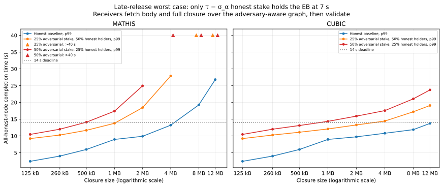

# Leios closure diffusion after certification: numerical report

## Summary

This report estimates how long it takes until **every honest node has
received and validated an endorser block's (EB's) transaction closure**,
given that the EB is certified.  The closure is the set of transactions the
EB references.  The estimates come from a numerical model of a 2,500-node
network under two TCP models, Mathis (Reno/AIMD) and CUBIC; they include CPU
processing time, but they are not measurements.  All times are measured from
the start of EB diffusion, against a 7-second voting deadline and a
14-second diffusion window.

The main results are as follows:

- **At the Musashi testnet's 260 kB closure limit**, every honest node has
  validated the closure by **4.01 s** with 99% probability under both
  network models.  An adversary with nearly 50% of stake who releases the EB
  as late as it can while still getting it certified raises this to
  **12.02 s**, still within the 14-second window.
- **Without an adversary, closures up to 2 MB fit the 14-second window**, and
  certification is effectively certain.  The 99th-percentile completion time
  at 2 MB is 9.91 s under Mathis and 9.75 s under CUBIC.
- **Larger closures stop certifying**.  From 4 MB under Mathis and from 8 MB
  under CUBIC, too few committee members validate the closure by 7 s, and
  certification becomes vanishingly unlikely.
- **Losing cached transactions during recovery** (§3.2) leaves the 260 kB
  result unchanged, because the 99th-percentile event occurs before 7 s.  At
  2 MB, it raises the Mathis figure to 15.85 s.
- **The late-release worst case** (§3.3) exceeds 14 s from 500 kB under
  Mathis and from 1 MB under CUBIC.

The 99th-percentile time by which all honest nodes are ready, in seconds, is
as follows:

| Closure | Baseline, Mathis | Baseline, CUBIC | Stress, Mathis | Stress, CUBIC | Worst case, Mathis | Worst case, CUBIC |
|---:|---:|---:|---:|---:|---:|---:|
| 260 kB | 4.01 | 4.01 | 4.01 | 4.01 | 12.02 | 12.02 |
| 500 kB | 5.98 | 5.98 | 5.98 | 5.98 | 14.11 | 13.12 |
| 1 MB | 8.97 | 8.97 | 12.08 | 10.54 | 17.39 | 14.36 |
| 2 MB | 9.91 | 9.75 | 15.85 | 11.17 | 24.94 | 15.91 |
| 4 MB | 13.22 | 10.81 | 26.30 | 12.43 | >40 | 17.56 |

Baseline and stress times are conditional on certification, which at 4 MB
under Mathis has probability below $10^{-20}$.  The worst case assumes 50%
adversarial stake and needs no conditioning (§3.3).

The model considers one EB in isolation, on a synthetic stake distribution.
§1 lists its inputs and §4 its limitations.  It extends the
[conditional-certification analysis](../analysis/deltaq/improved-leios/conditional_certification_diffusion.md)
to closures from 125 kB to 12 MB.

## 1. What the numbers mean

The **closure size** is the total size of referenced transactions, not the EB
body size and not the amount each node must fetch.  With the assumed cache miss
rate of one sixth, a 500 kB closure requires fetching approximately **83 kB**
of missing transactions; the node still processes the whole closure.

**Units**: all sizes in this report use decimal units: kB = 1,000 bytes
and MB = 1,000,000 bytes.

The model follows each node in two phases.  Before the 7-second voting
deadline, every node receives the EB body, fetches the transactions it is
missing, and validates the closure; this phase decides whether the EB
certifies.  If it does, nodes still missing data recover it from nodes that
hold it, over the short paths of a stake-weighted peer graph (Appendix B),
and then reapply the closure.  Appendices A and C give the details.  The
stress (§3.2) and worst-case (§3.3) scenarios change the recovery
assumptions, as described in their sections.

The tables use the following two probabilities:

- **Voter ready by 7 s**: one node has received the body, fetched its missing
  transactions, and completed the voter validation work by the voting deadline.
- **All ready by $t$, given $C$**: every honest node has received the body,
  fetched its missing transactions, and completed reapplication by time $t$,
  conditional on the certification event $C$. This is a strict **all-node**
  target, not an average node, a stake fraction, or 99% of nodes.

All times are measured from the model's EB diffusion origin.  The checkpoints
are **7 s** (voting deadline) and **14 s** (end of the diffusion window).  A p99
time is the time by which the all-node completion event has probability at least
99%, conditional on certification.

### 1.1. Fixed inputs

| Input | Value used |
|:---|:---|
| Node population | 2,500; all honest in the baseline |
| Committee | Deterministic top-stake selection of 900 pools; synthetic stake coverage approximately 98.84% |
| Stake distribution | Synthetic power-law distribution in `analysis.py`; not an observed stake snapshot |
| Certification threshold | 75% of total active stake; approximately 75.88% of committee stake |
| Voting / diffusion deadline | 7 s / 14 s |
| Stationary missing transaction fraction | Every node fetches 1/6 of the closure (approximately 16.67%) |
| Phase-one missing-transaction fetch | Full blended one-to-five-hop distribution; determines voter readiness and $P(C)$ |
| Phase-two recovery | Begins no earlier than 7 s, conditional on certification: 76.58% one hop, 23.41% two hops, 0.01% three hops; see Appendices A and B |
| Recovery graph | 2,500 nodes; 5 distinct stake-weighted peers each; holders carry 25% of stake; 16 graphs and 256 holder draws, seed 164 |
| Stress recovery | Every node not validated by 7 s fetches the full closure; same phase one and recovery-hop distribution; see §3.2 |
| EB-body diffusion | Full blended one-to-five-hop distribution from `report.md` §4.2 |
| EB body | Fixed size for each closure: closure size × 40/260; 40 kB at a 260 kB closure |
| Average transaction size | 1,000 bytes |
| CPU means | Initial validation: approximately 0.1428 ms/transaction; recovery reapply: 0.070 ms/transaction |
| Quorum calculation | 50,000 seeded pool permutations (seed 164); binomial mixture evaluated in log space |
| Network models | Mathis (Reno/AIMD) and CUBIC |
| Packet loss / interface cap | 0.0001 / 1 Gbit/s |
| Short / medium / long RTT | 12 / 69 / 268 ms |
| Numerical time grid | 10 ms, extending to 40 s |

The selection rule follows the ledger's
[`selectLeiosCommittee`](https://github.com/IntersectMBO/cardano-ledger/blob/leios-prototype/libs/cardano-ledger-core/src/Cardano/Ledger/State/LeiosCommittee.hs):
take the configured number of pools in descending active-stake order, or all
candidates if fewer; equal-stake ties use ascending pool ID.  The synthetic
model carries no pool IDs, so equal-stake ties are interchangeable.  Coverage is
an outcome of selection, not a 99% target.  All selected seats are assumed to
have usable voting keys; the implementation can retain keyless seats when keys
are missing, expired, or have invalid proofs of possession.

The [pinned Musashi genesis](../testnet/config/dijkstra-genesis.json) sets
`leiosCommitteeSize=900`, `maxEndorserBlockTxsSize=260000`, and the separate
references-size limit to 40,000 bytes.  The 260 kB closure limit is a maximum,
not a measured average; transaction supply, packing, and execution limits can
produce smaller closures.  Its missing-transaction fetch is approximately
43 kB under the assumed one-sixth miss rate.  This remains an isolated-EB,
2,500-node model with the timing and network inputs above, rather than a full
calibration to Musashi's population, stake snapshot, or period lengths.

The same body-to-closure ratio applies to every size, without a cap.  For
example, a 4 MB closure has a 615 kB body and a 12 MB closure has a
1,846 kB body.  This is a modelling rule, not a measured encoding ratio;
larger rows extrapolate beyond Musashi's 40 kB references-size limit and
should not be interpreted as valid Musashi configurations.

## 2. Honest-baseline probabilities and completion times

The baseline has no adversarial nodes; every figure in this section targets
all 2,500 honest nodes.  Probabilities are percentages to two significant
figures.  Near 100%, the significant figures are those of the shortfall, so
99.9967% means a 0.0033% chance that some node is not ready.  Values below
0.0001% or above 99.9999% are shown as `<0.0001%` and `>99.9999%`, and
certification probabilities below $10^{-20}$ as `<10⁻¹⁸%`.  These bounds do
not imply impossibility or certainty, and such tails depend on the finite
permutation sample of Appendix D.  Times are in seconds.  Smaller closures
saturate the probability tables; the completion times in §2.3 show their
more informative differences.

### 2.1. Certification and completion probabilities

| Closure | Body (kB) | Missing txs (kB) | Voter ready by 7 s, Mathis | Voter ready by 7 s, CUBIC | $P(C)$, Mathis | $P(C)$, CUBIC |
|---:|---:|---:|---:|---:|---:|---:|
| 125 kB | 19 | 21 | >99.9999% | >99.9999% | >99.9999% | >99.9999% |
| 260 kB | 40 | 43 | >99.9999% | >99.9999% | >99.9999% | >99.9999% |
| 500 kB | 77 | 83 | >99.9999% | >99.9999% | >99.9999% | >99.9999% |
| 1 MB | 154 | 167 | 99.980% | 99.980% | >99.9999% | >99.9999% |
| 2 MB | 308 | 333 | 93.6% | 95.0% | >99.9999% | >99.9999% |
| 4 MB | 615 | 667 | 55% | 81% | <10⁻¹⁸% | 99.64% |
| 8 MB | 1,231 | 1,333 | 17% | 54% | <10⁻¹⁸% | <10⁻¹⁸% |
| 12 MB | 1,846 | 2,000 | 4.6% | 37% | <10⁻¹⁸% | <10⁻¹⁸% |

The probability that all honest nodes are ready, given certification, is as
follows:

| Closure | By 7 s, Mathis | By 7 s, CUBIC | By 14 s, Mathis | By 14 s, CUBIC |
|---:|---:|---:|---:|---:|
| 125 kB | >99.9999% | >99.9999% | >99.9999% | >99.9999% |
| 260 kB | >99.9999% | >99.9999% | >99.9999% | >99.9999% |
| 500 kB | 99.9967% | 99.9967% | >99.9999% | >99.9999% |
| 1 MB | 61% | 61% | >99.9999% | >99.9999% |
| 2 MB | <0.0001% | <0.0001% | >99.9999% | >99.9999% |
| 4 MB | <0.0001% | <0.0001% | 99.9988% | >99.9999% |
| 8 MB | <0.0001% | <0.0001% | <0.0001% | 99.9999% |
| 12 MB | <0.0001% | <0.0001% | <0.0001% | 99.39% |

A high individual voter readiness probability does not imply that every node
is ready.  For example, at 2 MB under Mathis, individual voter readiness at
7 s is **93.6%**, while all-node completion is **<0.0001%**.  Certification
only requires the stake quorum, so it remains effectively certain.

### 2.2. Conditional completion CDFs

All plots and tables use the **two-phase node process** defined in
Appendices A and C; the graph-derived recovery-hop distribution does not
enter $P(C)$.

Each curve shows the probability that all 2,500 honest nodes are ready by
time $t$, given certification, for one closure size; every closure size has
a plotted curve.  Vertical dotted lines mark the 7 and 14 s table
checkpoints.  Colours identify the same closure sizes in all CDF plots.


*Figure 1*.  Under Mathis, the curves up to 2 MB reach 100% before 11 s,
and the 4 MB curve just before 14 s.  The 8 and 12 MB curves rise only after
the 14-second deadline.


*Figure 2*.  Under CUBIC, every curve up to 8 MB reaches 100% before 14 s;
only the 12 MB curve, at 99.39%, has not.

### 2.3. Completion times by closure size

| Closure | p50, Mathis | p50, CUBIC | p95, Mathis | p95, CUBIC | p99, Mathis | p99, CUBIC | p99.9, Mathis | p99.9, CUBIC |
|---:|---:|---:|---:|---:|---:|---:|---:|---:|
| 125 kB | 2.16 | 2.16 | 2.40 | 2.40 | 2.45 | 2.45 | 2.67 | 2.67 |
| 260 kB | 3.53 | 3.53 | 3.92 | 3.92 | 4.01 | 4.01 | 4.36 | 4.36 |
| 500 kB | 5.27 | 5.27 | 5.83 | 5.83 | 5.98 | 5.98 | 6.50 | 6.50 |
| 1 MB | 6.98 | 6.98 | 8.06 | 8.06 | 8.97 | 8.97 | 9.00 | 9.00 |
| 2 MB | 9.88 | 9.72 | 9.90 | 9.74 | 9.91 | 9.75 | 10.24 | 10.05 |
| 4 MB | 11.30 | 10.42 | 12.29 | 10.44 | 13.22 | 10.81 | 13.78 | 11.94 |
| 8 MB | 16.46 | 11.27 | 18.64 | 11.80 | 19.26 | 11.89 | 21.43 | 13.20 |
| 12 MB | 22.89 | 11.91 | 25.93 | 13.08 | 26.80 | 13.75 | 29.80 | 14.62 |

For smaller closures, these **timing margins** are more informative than the
rounded 14-second probabilities.  Reducing a closure from 500 kB to 125 kB
also shrinks the EB body from 77 kB to 19 kB, cutting p99 completion time by
**3.53 s under both network models**.  These rows model jointly smaller
bodies and closures, not just cheaper closure fetches.

At 500 kB, the honest p99 time leaves **8.02 s** before the 14-second
deadline under both models.  At 4 MB, conditional p99 leaves **0.78 s under
Mathis** and **3.19 s under CUBIC**; the Mathis certificate itself is
extremely unlikely.  These are model timing margins, not measured budgets
for additional traffic or implementation overhead.

The percentile plot uses a logarithmic closure-size axis to keep the smaller
sizes legible.  Each panel includes the honest p50, p95, p99, and p99.9
times, with the active-adversary p99 from §3.1 shown as a dashed black line.
The rightmost point is 12 MB under both models.


*Figure 3*.  All four percentiles stay below the 14-second line up to 4 MB
under Mathis and up to 8 MB under CUBIC.  The dashed active-adversary p99
lies on or just below the honest p99.

## 3. Adversarial and stress scenarios

### 3.1. Active adversarial voting

This scenario follows §8 of the
[original note](../analysis/deltaq/improved-leios/conditional_certification_diffusion.md):
an adversary controls **25% of committee stake**, about 24.7% of total
stake, and always votes on time.  Assuming the same fraction by node count,
the completion target shrinks to the remaining **1,875** honest nodes.  The
adversary still relays bodies and transactions like an honest node, so it
affects only the certification condition and the size of the target.  The
note chose 25% for illustration, just past the approximately 24% at which
withheld votes could block certification; it is not derived from a safety
requirement.  §3.3 models an adversary that also withholds diffusion.

The table compares the honest p99 of §2.3 with the active-adversary p99.
Active p99 is never later and at most 0.84 s earlier, because a smaller
target is easier to complete; this is not evidence that adversarial voting
improves diffusion.  Raising the adversarial share towards 50% changes these
results by less than a second.

| Closure | Honest p99, Mathis | Honest p99, CUBIC | Active p99, Mathis | Active p99, CUBIC | Active ready by 14 s, Mathis | Active ready by 14 s, CUBIC |
|---:|---:|---:|---:|---:|---:|---:|
| 125 kB | 2.45 | 2.45 | 2.45 | 2.45 | >99.9999% | >99.9999% |
| 260 kB | 4.01 | 4.01 | 4.01 | 4.01 | >99.9999% | >99.9999% |
| 500 kB | 5.98 | 5.98 | 5.98 | 5.98 | >99.9999% | >99.9999% |
| 1 MB | 8.97 | 8.97 | 8.28 | 8.28 | >99.9999% | >99.9999% |
| 2 MB | 9.91 | 9.75 | 9.91 | 9.75 | >99.9999% | >99.9999% |
| 4 MB | 13.22 | 10.81 | 12.38 | 10.78 | 99.9991% | >99.9999% |
| 8 MB | 19.26 | 11.89 | 19.25 | 11.88 | 0.0015% | 99.9999% |
| 12 MB | 26.80 | 13.75 | 26.78 | 13.18 | <0.0001% | 99.53% |

The CDFs below correspond to Figures 1 and 2, with the same axes and size
colours, but target the 1,875 honest nodes of this scenario.


*Figure 4*.  The Mathis curves closely follow Figure 1; at 1 and 4 MB, they
reach 99% up to 0.84 s earlier.


*Figure 5*.  The CUBIC curves closely follow Figure 2; at 1 and 12 MB, they
reach 99% up to 0.69 s earlier.

### 3.2. No prior availability at remaining honest nodes: stress scenario

This scenario removes the stationary-cache availability assumption from
**recovery only**.  Phase-one fetching, validation, and the certification
event are identical to the baseline.  A node already validated by the
7-second deadline remains complete.  Every other honest node is treated as
holding none of the transactions and fetches the **entire closure**, even if
it had previously acquired data and was still validating it.  Thus the
recovery payload at 260 kB is **260 kB**, compared with **43 kB** for a
baseline node still missing data.

Using the notation from Appendix C, let $R_{\mathrm{full}}$ transfer the
full closure over the same graph-derived recovery-hop distribution.  The
stress completion time is:

$$
D_{\mathrm{stress}}=\begin{cases}
V, & V\le t_v,\\
\max(B,t_v)+R_{\mathrm{full}}+Y, & V>t_v.
\end{cases}
$$

The already-ready nodes are retained, so the same joint-readiness identity
and quorum coefficients apply.  Both honest-baseline and active-adversary
certification probabilities are unchanged; only conditional completion
changes.  All times below are measured from EB diffusion, not from
certification.

| Closure | Baseline p99, Mathis | Baseline p99, CUBIC | Stress p99, Mathis | Stress p99, CUBIC | Stress p99.9, Mathis | Stress p99.9, CUBIC | Stress ready by 14 s, Mathis | Stress ready by 14 s, CUBIC |
|---:|---:|---:|---:|---:|---:|---:|---:|---:|
| 125 kB | 2.45 | 2.45 | 2.45 | 2.45 | 2.67 | 2.67 | >99.9999% | >99.9999% |
| 260 kB | 4.01 | 4.01 | 4.01 | 4.01 | 4.36 | 4.36 | >99.9999% | >99.9999% |
| 500 kB | 5.98 | 5.98 | 5.98 | 5.98 | 6.50 | 6.50 | >99.9999% | >99.9999% |
| 1 MB | 8.97 | 8.97 | 12.08 | 10.54 | 12.10 | 10.56 | 99.9997% | >99.9999% |
| 2 MB | 9.91 | 9.75 | 15.85 | 11.17 | 16.94 | 11.66 | 1.5% | >99.9999% |
| 4 MB | 13.22 | 10.81 | 26.30 | 12.43 | 32.06 | 14.11 | <0.0001% | 99.75% |
| 8 MB | 19.26 | 11.89 | >40 | 15.58 | >40 | 16.69 | <0.0001% | 94.2% |
| 12 MB | 26.80 | 13.75 | >40 | 17.79 | >40 | 18.66 | <0.0001% | <0.0001% |

The stress assumption has no effect on the displayed p99 and p99.9 for
closures through 500 kB: those completion quantiles are already before 7 s,
when the node process is identical.  It substantially increases recovery
times for larger closures.  With the 25% active adversary of §3.1, stress
p99 is up to 1.84 s earlier under Mathis and up to 1.37 s earlier under
CUBIC, for the same reason as in §3.1.  As throughout the report, a
favourable conditional completion figure does not imply that the certificate
is likely to form.

`>40` means the percentile lies beyond the 40-second numerical horizon; it
is not an estimate of the actual percentile.  The Mathis 8 and 12 MB stress
CDFs have not reached the target percentile by the right edge of the plot.
Upward triangles at 40 s mark these censored cases in the percentile
comparison; they are not plotted as measured 40-second completion times.


*Figure 6*.  Up to 500 kB, the Mathis stress curves match Figure 1.  From
2 MB, they cross 14 s far below 100%, and the 8 and 12 MB curves do not reach
99% within the 40-second horizon.


*Figure 7*.  Under CUBIC, the stress curves up to 4 MB pass 99% before 14 s.
The 8 MB curve reaches 94.2% at 14 s, and the 12 MB curve rises only after
it.


*Figure 8*.  The stress and baseline lines coincide up to 500 kB and
separate from 1 MB.  Triangles mark Mathis percentiles beyond the 40-second
horizon.

This tests the effect of losing prior transaction availability outside the
validated population.  It is not a formal adversarial worst-case bound:
immediate serving availability, short recovery paths, independent requests,
and no serving-capacity contention remain assumptions.  It is a separate
stress scenario rather than a change to the stationary-cache baseline.

### 3.3. Late-release safety worst case

Linear Leios should not weaken Praos safety, even when the adversary
controls stake $\sigma_\alpha$ approaching 50%.  Such an adversary supplies
$\sigma_\alpha$ of the $\tau=75\%$ quorum, so a certificate only guarantees
that honest nodes with $\tau-\sigma_\alpha$ of stake, about 25%, have the
EB.  Adversarial nodes need not help anyone else.

This scenario models that case as follows:

1. The adversary releases the EB so late that, at the 7-second vote
   deadline, only honest holders with exactly $\tau-\sigma_\alpha$ of stake
   have the body and closure.  Every other honest node has neither, and uses
   no transactions from its cache.  The adversary votes on time, so
   certification is certain and nothing is conditioned.
2. From 7 s, each remaining honest receiver fetches the body and then the
   full closure, each over the reachable hop distribution in Appendix B for
   $m=5$, holder stake $\tau-\sigma_\alpha$, and non-forwarding adversarial
   stake $\sigma_\alpha$.  It then validates the closure in full.
3. Receivers complete independently.  Their number is the mean count of
   honest nonholders in the graph draws: 619 at $\sigma_\alpha=25\%$ and 620
   at $\sigma_\alpha=50\%$.

The columns are grouped by adversarial stake $\sigma_\alpha$: at 25%, the
honest holders carry 50% of stake, and at 50%, they carry 25%.

#### Mathis

| Closure | p50, 25% | p99, 25% | Ready by 14 s, 25% | Ready by 20 s, 25% | p50, 50% | p99, 50% | Ready by 14 s, 50% | Ready by 20 s, 50% |
|---:|---:|---:|---:|---:|---:|---:|---:|---:|
| 125 kB | 8.87 | 9.23 | >99.9999% | >99.9999% | 9.35 | 10.47 | >99.9999% | >99.9999% |
| 260 kB | 9.73 | 10.28 | >99.9999% | >99.9999% | 10.52 | 12.02 | 99.9996% | >99.9999% |
| 500 kB | 10.89 | 11.69 | >99.9999% | >99.9999% | 12.09 | 14.11 | 98.8% | >99.9999% |
| 1 MB | 12.64 | 13.78 | 99.26% | >99.9999% | 14.23 | 17.39 | 39% | 99.9943% |
| 2 MB | 16.64 | 18.45 | 1.8% | 99.65% | 18.92 | 24.94 | <0.0001% | 56% |
| 4 MB | 25.09 | 27.90 | <0.0001% | 13% | 28.83 | >40 | <0.0001% | <0.0001% |
| 8 MB | >40 | >40 | <0.0001% | <0.0001% | >40 | >40 | <0.0001% | <0.0001% |
| 12 MB | >40 | >40 | <0.0001% | <0.0001% | >40 | >40 | <0.0001% | <0.0001% |

#### CUBIC

| Closure | p50, 25% | p99, 25% | Ready by 14 s, 25% | Ready by 20 s, 25% | p50, 50% | p99, 50% | Ready by 14 s, 50% | Ready by 20 s, 50% |
|---:|---:|---:|---:|---:|---:|---:|---:|---:|
| 125 kB | 8.87 | 9.23 | >99.9999% | >99.9999% | 9.35 | 10.47 | >99.9999% | >99.9999% |
| 260 kB | 9.73 | 10.28 | >99.9999% | >99.9999% | 10.52 | 12.02 | 99.9996% | >99.9999% |
| 500 kB | 10.39 | 11.12 | >99.9999% | >99.9999% | 11.48 | 13.12 | 99.930% | >99.9999% |
| 1 MB | 11.18 | 12.09 | 99.9989% | >99.9999% | 12.47 | 14.36 | 97.0% | >99.9999% |
| 2 MB | 12.33 | 13.29 | 99.87% | >99.9999% | 13.79 | 15.91 | 70% | >99.9999% |
| 4 MB | 13.48 | 14.45 | 97.3% | >99.9999% | 15.13 | 17.56 | 8.1% | 99.987% |
| 8 MB | 15.55 | 17.21 | 6.6% | 99.9989% | 17.78 | 21.07 | <0.0001% | 96.5% |
| 12 MB | 17.18 | 19.09 | <0.0001% | 99.81% | 19.84 | 23.73 | <0.0001% | 61% |



*Figure 9*.  Both adversarial p99 curves start several seconds above the
honest baseline.  The 50% curve crosses the 14-second line at 500 kB under
Mathis and at 1 MB under CUBIC.

At Musashi's 260 kB limit with $\sigma_\alpha=50\%$, p99 is **12.02 s**
under both models, compared with **4.01 s** in the honest baseline, and all
honest nodes are ready by 14 s with probability **99.9996%**.  Under Mathis,
p99 exceeds 14 s from 500 kB (**14.11 s**); under CUBIC, from 1 MB
(**14.36 s**).  At $\sigma_\alpha=25\%$, p99 stays within 14 s up to 1 MB
under Mathis (13.78 s) and up to 2 MB under CUBIC (13.29 s).  Most of the
gap to the baseline is structural: receivers start only at 7 s, transfer the
body and the whole closure, and validate it in full.

This is a sketch of the worst case rather than a bound.  Starting every
receiver at 7 s is pessimistic by the holders' own validation time, since
honest holders forward data as soon as they have it, and so is ignoring
cache contents.  Uncontended holder uploads are optimistic, and receivers
with no honest route (3.41% at $\sigma_\alpha=50\%$ on the static graph in
Appendix B) are excluded.  Whether an adversary can time the release this
precisely depends on header and EB diffusion rules not modelled here.  The
safety question is whether these times fit within the window that
$L_{\mathrm{diff}}$ allows; this report measures them against the 14-second
deadline used throughout.

## 4. Scope and limitations

The figures above rest on the following assumptions:

**Isolated scenario**.  The model considers one EB in isolation.  Concurrent
EBs, background transaction traffic, and resource contention are not
modelled, so these tables do not determine sustainable throughput or a
production closure-size limit.

**Independent nodes**.  Node completion times are independent and
stake-independent.  Shared network paths, correlated cache misses, and
differences in SPO connectivity are not represented.

**Idealised recovery**.  Recovery assumes certified holders serve
immediately at 7 s with uncontended uploads.  Unfinished missing batches
restart from scratch, ignoring partial progress.  Real certificate arrival,
fetching overlap, and shared serving capacity can change the results.

**Static peer graph**.  Peers are fixed, stake-weighted, and do not change
over time: no churn, replacement, or multiple relays.  The active-adversary
comparison reuses the adversary-free hop distribution, though non-forwarding
adversaries would shift some two-hop paths to three hops or leave receivers
without a route (Appendix B).

**Approximate quorum calculation**.  Quorum probabilities use a permutation
estimate (50,000 samples), not an exact enumeration.  Decimal precision aids
reproducibility but does not imply confidence in extremely rare
probabilities.  A silent adversary withholding 25% of committee stake would
leave ~74.13% of active stake, below quorum, so that impossible event has no
conditional completion distribution and is not tabulated.

**Discrete numerical grid**.  The 10 ms time grid and fixed transfer
mixtures create plateaus and sharp tail changes.

## 5. Reproducing the tables and plots

The tables and plots use the component laws in
[`analysis.py`](../analysis/deltaq/improved-leios/analysis.py), combined by the
causal process and quorum calculation in
[`two_phase.py`](../analysis/deltaq/improved-leios/two_phase.py), with the fixed
inputs above.  The
[report generator](../analysis/deltaq/improved-leios/closure_diffusion.py)
prints the four baseline tables, the stress table, the two safety
worst-case tables, and the recovery-path table, writes ten SVG plots to
`docs/conditional-certification-diffusion/`, and checks that the computed CDFs
are bounded and non-decreasing, that certification probabilities are
non-negative and bounded, and that conditional curves agree numerically with the
two-phase node CDF raised to the population count when certification saturates.
CDF monotonicity is checked without repair.

From the repository root, in a Python environment with NumPy, SciPy, and
Matplotlib installed:

```sh
python3 analysis/deltaq/improved-leios/closure_diffusion.py
```

The targeted tests cover phase timing, retained validation, late bodies,
recovery and stress independence of certification, small exact conditional
examples, quorum-coefficient estimation, log-space underflow handling,
recovery-graph construction, path direction, adversarial transit, the one-hop
closed form, and the late-release worst case:

```sh
python3 -m unittest discover -s analysis/deltaq/improved-leios -p 'test_*.py'
```

For the mathematical derivation and broader discussion, see the
[original note](../analysis/deltaq/improved-leios/conditional_certification_diffusion.md);
for the component network and CPU models, see the
[full analysis report](../analysis/deltaq/improved-leios/report.md).

**Changes from earlier versions of this analysis**: the results above differ
from earlier versions in the following ways:

- Quorum probabilities use the seeded permutation estimate of Appendix D
  instead of a Normal-tail approximation.
- The two-phase node process in `two_phase.py` replaces the mixed-readiness
  approximation in `analysis.py`.  Its quorum argument is the conditional
  voter probability $H/F_D$ of Appendix C, rather than a substitution
  involving $F_V(t_v)/F_V(t)$, and its CDFs are non-decreasing without
  taking a running maximum.
- Summed durations are placed at their exact summed time, correcting a
  one-bin advance per convolution.
- Recovery hops come from the peer graph of Appendix B instead of a fixed
  50% one-hop and 50% two-hop split.  The resulting three-hop tail lowers
  the probability that all nodes are ready 10 s after diffusion starts, at
  2 MB under Mathis, from >99.9999% to 99.73%.

## Appendix A. Fixed missing-transaction fetch model

A node's **missing-transaction batch** is every closure transaction that the
node lacks, fetched as one bulk transfer.  The model uses separate paths
for the whole batch before and after the voting deadline, as follows:

| Path length | Phase-one fetch | Phase-two recovery |
|---:|---:|---:|
| 1 hop | 0.40% | 76.58% |
| 2 hops | 3.91% | 23.41% |
| 3 hops | 31.06% | 0.01% |
| 4 hops | 61.85% | 0% |
| 5 hops | 2.78% | 0% |

**Phase one**: every honest node attempts to acquire and validate the closure.
Voter readiness and the unconditional certification probability $P(C)$ use only
the full blended fetch law and initial validation.  Nodes outside the committee
also follow this initial processing law, but do not vote.

**Phase two starts at 7 s, conditional on certification**.  A node already
validated remains complete.  A node that has fetched its entire missing batch
continues any validation still in progress.  A node still missing data uses
the short-path recovery law, beginning at the later of 7 s and its body arrival,
then reapplies the closure.  Already completed data fetching is retained;
partial bytes of an unfinished batch are not credited, so that batch is
restarted in full.  This is a deliberately coarse batch-level progress model.

Certified holders are assumed to be immediately available as serving sources
at the deadline.  There is no additional certificate-construction, delivery,
source-discovery, or queueing delay.  Recovery does not happen on a branch
where certification fails.  This is a fixed-deadline model, not a model of
the earliest possible quorum time or per-node certificate arrival.

The generator derives `DEFAULT_HOP_WEIGHTS` from the recovery graph in
Appendix B and uses it for recovery only.  These weights come from a graph
model; they are not measured mainnet frequencies.  EB bodies retain the full
blended distribution from
[`report.md` §4.2](../analysis/deltaq/improved-leios/report.md#42-network-model),
implemented by `cdf_blended_delay` using `analysis.py`'s `_HOP_PROBS`.
Multi-hop fetching represents data being acquired upstream before it reaches
the requesting node.
Each hop transfers the same missing batch using the short/medium/long-distance
transfer law of `report.md`, independently of the other hops; hop CDFs are
convolved sequentially without pipelining.

The **stationary transaction-cache miss fraction is 1/6 at every node**.  Each
node therefore fetches a batch of size `closure / 6`, with the path length drawn
from the applicable phase's distribution.  There is no additional 5/6
probability of a full-closure cache hit.  This is a mean-fraction approximation:
it does not sample which individual transactions are missing or model them
taking different paths.  The model also omits peer-discovery delays, timeouts,
retries, and contention.

Only the missing fraction traverses these fetch paths; this is not the
§5.3 catastrophic pre-diffusion-failure scenario in `report.md`, in which the
entire closure must traverse the network.

## Appendix B. Graph-derived recovery paths

The phase-two recovery-hop distribution comes from
[`recovery_graph.py`](../analysis/deltaq/improved-leios/recovery_graph.py),
which builds the following model:

1. Create **2,500 nodes** with the synthetic stake distribution.  Each node
   chooses $m$ **distinct peers** in proportion to their stake, excluding
   itself.  An edge $i\to j$ means that $i$ can request data from $j$.
2. Order the nodes uniformly at random.  The shortest prefix carrying at
   least stake fraction $f$ holds the closure.  Where an adversary is
   present, the next prefix carrying at least the adversarial stake neither
   serves nor forwards.  All remaining nodes are honest receivers.
3. Find each receiver's shortest path to a holder through honest nodes only.
   Path lengths are pooled over receivers, not over stake.
4. Sample **16 graphs** for each peer count and **256 role draws** for each
   stake split, with **seed 164**.

A stake-weighted peer is a holder with probability close to $f$, so a
receiver reaches a holder in one hop with probability close to
$1-(1-f)^m$.  Choosing distinct peers makes the sampled value slightly
higher.  The result depends on the holders' stake, not on which nodes they
are.  The holders actually conditioned on certification lean towards
high-stake pools, but for a given $f$ this leaves the one-hop probability
unchanged.

| Peers | Holder stake | Adversarial stake | One hop | Closed form | Two hops | Three+ hops | Unreachable | All reachable |
|---:|---:|---:|---:|---:|---:|---:|---:|---:|
| 5 | 25% | 0% | 76.58% | 76.27% | 23.41% | 0.01% | 0.00% | 100.00% |
| 5 | 25% | 25% | 76.64% | 76.27% | 22.70% | 0.57% | 0.09% | 34.38% |
| 5 | 25% | 50% | 76.48% | 76.27% | 18.03% | 2.08% | 3.41% | 0.00% |
| 5 | 50% | 0% | 97.00% | 96.88% | 3.00% | 0.00% | 0.00% | 100.00% |
| 5 | 50% | 25% | 97.02% | 96.88% | 2.88% | 0.02% | 0.09% | 57.03% |
| 5 | 75% | 0% | 99.92% | 99.90% | 0.08% | 0.00% | 0.00% | 100.00% |
| 10 | 25% | 0% | 94.62% | 94.37% | 5.38% | 0.00% | 0.00% | 100.00% |
| 10 | 25% | 25% | 94.65% | 94.37% | 5.35% | 0.00% | 0.00% | 100.00% |
| 10 | 25% | 50% | 94.57% | 94.37% | 5.31% | 0.03% | 0.10% | 56.64% |
| 10 | 50% | 0% | 99.92% | 99.90% | 0.08% | 0.00% | 0.00% | 100.00% |
| 10 | 50% | 25% | 99.92% | 99.90% | 0.08% | 0.00% | 0.00% | 100.00% |
| 10 | 75% | 0% | 100.00% | 100.00% | 0.00% | 0.00% | 0.00% | 100.00% |
| 20 | 25% | 0% | 99.73% | 99.68% | 0.27% | 0.00% | 0.00% | 100.00% |
| 20 | 25% | 25% | 99.73% | 99.68% | 0.27% | 0.00% | 0.00% | 100.00% |
| 20 | 25% | 50% | 99.74% | 99.68% | 0.26% | 0.00% | 0.00% | 100.00% |
| 20 | 50% | 0% | 100.00% | 100.00% | 0.00% | 0.00% | 0.00% | 100.00% |
| 20 | 50% | 25% | 100.00% | 100.00% | 0.00% | 0.00% | 0.00% | 100.00% |
| 20 | 75% | 0% | 100.00% | 100.00% | 0.00% | 0.00% | 0.00% | 100.00% |


*Figure 10*.  The sampled one-hop probabilities (dots) lie just above the
closed form (dashed lines) for every peer count.  With 10 or more peers and
holders carrying 50% of stake, almost every receiver is one hop away.

**Choice for the timing model**.  Phase two uses $m=5$, the current number
of peers per relay, and $f=25\%$ without adversaries: 76.58% one hop,
23.41% two hops, and 0.01% three hops.  Given certification, nodes validated
by 7 s carry at least 75% of stake in the baseline, so 25% is conservative
there.  It is the honest stake that remains in a quorum when an adversary
holding almost half the stake votes.  More peers make recovery faster
still: at $m=10$ and $f=25\%$, 94.62% of receivers are one hop away.

The three-hop tail is small but not negligible for a strict all-node target,
although the frequent one-hop paths keep most completion times short.

**Unreachable receivers are reported, not timed**.  Without adversaries, every
receiver has a route.  When adversaries neither serve nor forward, a receiver
whose peers are all adversarial has none: about $0.25^5\approx0.1\%$ of
receivers at 25% adversarial stake, and $0.5^5\approx3.1\%$ at 50%.  These are
lower bounds; the `Unreachable` column also counts receivers whose only routes
pass through adversarial nodes.  `All reachable` is the fraction of role draws
in which every receiver has a route.  The graph is static, whereas real nodes
replace peers that fail to deliver, so these figures overstate persistent
unreachability.  They therefore do not enter the completion-time calculation;
the timing model uses the hop distribution of reachable receivers.

Sampled figures are shown to two decimals.  `0.00%` means that no case was
observed among approximately 160,000 to 480,000 receiver samples; it is not a
zero probability.  Rounding may cause row sums to differ from 100% by 0.01%.

## Appendix C. Joint readiness and conditional completion

Let $B$ be body arrival, $U$ the phase-one missing-batch fetch duration,
$X$ initial validation, $R$ recovery duration, and $Y$ reapplication.  Component
durations are independent; both phases share the same body arrival.  Set
$L=B+U$, $V=L+X$, and define completion $D$ on a certified branch by:

$$
D = \begin{cases}
V, & L \le t_v,\\
\max(B,t_v)+R+Y, & L > t_v,
\end{cases}
\qquad t_v=7\ \mathrm{s}.
$$

Thus a node ready to vote is necessarily already complete.  For independent
node histories, the required joint probability is known explicitly:

$$
H(t_v,t)=P(V\le t_v,D\le t)=F_V(\min(t_v,t)).
$$

Writing $A_t$ for all honest nodes completing by $t$, the conditional CDF is:

$$
P(A_t\mid C)=F_D(t)^{N_h}
\frac{Q\!\left(H(t_v,t)/F_D(t)\right)}{Q(F_V(t_v))}.
$$

Inside $Q$, the voter probability is $H/F_D=P(V\le t_v\mid D\le t)$: the
probability that a node was ready to vote, given that it has completed by
$t$.  Here $N_h$ is the number of honest nodes.  The denominator and phase-one
vote readiness do not change when the recovery-hop distribution changes.
The identity is exact under the independent-node model with an exact $Q$;
the report approximates $Q$ using the reproducible method in Appendix D.

## Appendix D. Stake-weighted quorum calculation

For a committee of $K$ seats, let $a_k$ be the probability that a uniformly
chosen subset of $k$ seats carries quorum stake.  Then:

$$
Q(p)=\sum_{k=0}^{K} a_k {K\choose k}p^k(1-p)^{K-k}.
$$

The implementation estimates all $a_k$ using **50,000 uniform random pool
permutations**, with **seed 164**.  For each permutation it records the first
prefix whose stake reaches quorum; the empirical CDF of this prefix length
estimates $a_k$.  The same coefficients are used for the denominator and
conditional numerator.  This is not rejection sampling of rare certification
events, and the binomial mixture is evaluated in log space.

The non-negative mixture preserves a consistent probability model: the
conditional curves are bounded and non-decreasing without clipping excursions
or taking a running maximum.  Roundoff at unity is trimmed only within a
small numerical tolerance.  The quorum calculation is still a finite-sample
approximation to the exact stake-weighted distribution; very rare tails can
depend strongly on favourable subsets absent from the sample.

For the stylised active-adversary comparison, 25% of committee weight votes
deterministically and each stochastic seat's weight is scaled by 75%.
This does not identify an actual allocation of adversarial pools; the honest
completion target remains 1,875 nodes, as in §3.1.
